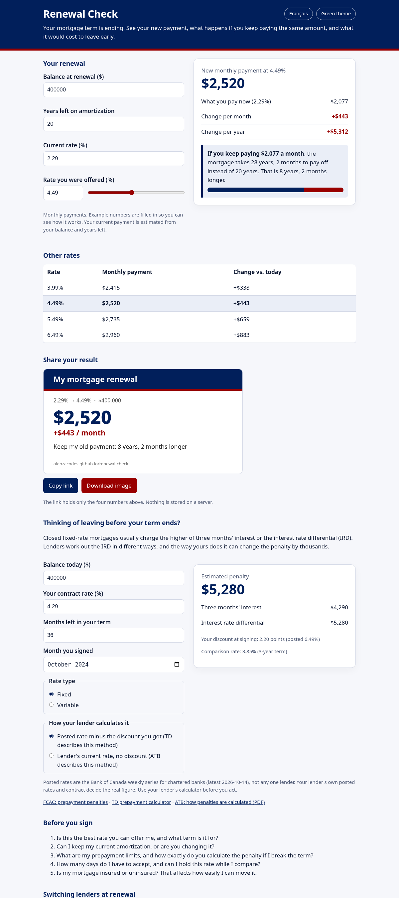
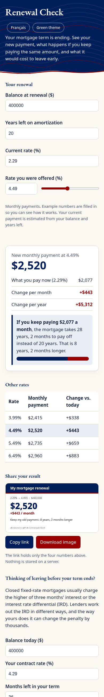
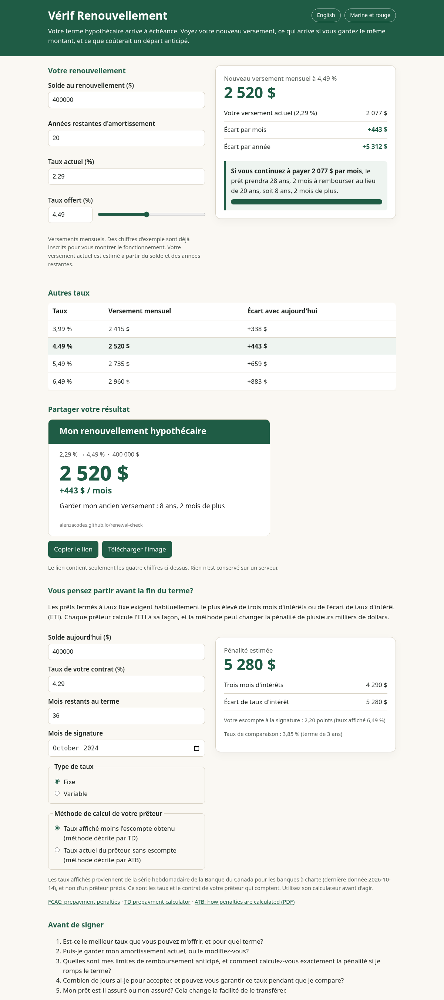

# Renewal Check

**Live:** https://alenzacodes.github.io/renewal-check/

For Canadian homeowners whose mortgage term is ending. Type in four numbers from your statement and the rate you were offered, and Renewal Check shows:

- your new monthly payment and the change per month and per year
- what happens if you keep paying what you pay now: how many years longer the mortgage takes, or a plain warning that the payment no longer covers the interest
- the same numbers at nearby rates, so you can see what half a point is worth before you negotiate
- what it would cost to leave your term early, using the two IRD methods lenders use and real Bank of Canada posted rates, including the posted rate in the month you signed
- a link and an image you can share, carrying only those four numbers

English and French. Works on a phone and with a keyboard or screen reader. Nothing you type leaves the page.

| Phone | Français |
|---|---|
|  |  |

## Run it

No install needed. Open the live link, or run locally:

    python3 -m http.server 8000

then open http://localhost:8000/.

## Tests

Needs Node 20 or later. No dependencies.

    node --test

18 tests check the payment maths against a standard table value, the penalty maths against the worked example from the Financial Consumer Agency of Canada, a grid of payment and payoff cases, sharing links, and that the English and French text match. They run on every push through GitHub Actions.

## How the maths works

- Payments use semi-annual compounding, the usual convention for Canadian fixed-rate mortgages: monthly rate = (1 + rate/2)^(1/6) - 1.
- Three months' interest = balance x rate / 12 x 3.
- Interest rate differential = balance x (your rate - comparison rate) / 12 x months left.
- Comparison rate depends on your lender. Some use today's posted rate for the closest term minus the discount you got when you signed (TD describes this). Others use their current rate with no discount (ATB describes this). Your contract decides.

Details are in `devpost/spec.md` and `src/mortgage.js`.

## Data and sources

- Bank of Canada, conventional mortgage rates for 1, 3 and 5-year terms (series V80691333, V80691334, V80691335), weekly averages of chartered banks' posted rates: https://www.bankofcanada.ca/valet/ . These are not any single lender's rates.
- FCAC, prepayment penalties: https://www.canada.ca/en/financial-consumer-agency/services/mortgages/reduce-prepayment-penalties.html
- TD prepayment calculator: https://apps.td.com/mortgage-prepayment-calculator/
- ATB, how penalties are calculated: https://www.atb.com/siteassets/legacy/HowPenaltiesCalculated.pdf
- OSFI, minimum qualifying rate for uninsured mortgages: https://www.osfi-bsif.gc.ca/en/supervision/financial-institutions/banks/minimum-qualifying-rate-uninsured-mortgages

Estimates only, not financial advice.

## Files

    index.html              the page
    src/app.js              form, results, sharing link and image
    src/mortgage.js         payment, payoff and penalty maths
    src/i18n.js             English and French text
    src/rates.js            Bank of Canada posted-rate snapshot
    src/style.css
    tests/                  maths and translation tests

## Limits

- Penalty estimates use the two common IRD methods. Your lender's contract decides the real figure.
- Posted rates are averages for chartered banks, not any one lender's rate.

## Planning documents

Built with the Devpost Learn Skill Pack for Build With AI: Basics. The plan is in `devpost/scope.md`, `devpost/prd.md` and `devpost/spec.md` (copies at the top level too).

## Licence
MIT. Copyright 2026 John Khan.
